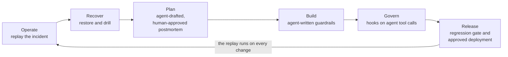

# Turn a production incident into guardrails

_Replay a real AI-agent incident with real Terraform, then build the guardrails that stop it._

On 26 February 2026, an AI coding agent ran `terraform destroy` with production's state
and deleted a course platform's infrastructure, including a database holding two and a
half years of student work. Its automated snapshots went with it. Recovery took about
24 hours.

In this exercise you replay that failure chain against a disposable production in your
Codespace, recover it, and then work through an agentic software development loop:
**agents investigate and propose, pipelines enforce, and humans decide.** By the end,
the incident is a regression test that CI runs on every change.

## Welcome

- **Who is this for**: platform engineers, DevOps engineers, SREs, and developers who use AI agents with infrastructure as code.
- **What you'll learn**: Terraform state and lifecycle protections, restore drills, blameless postmortems, Copilot custom agents and hooks, and approval-gated releases.
- **What you'll build**: A guardrail for every layer the incident crossed, each one proven by replaying the incident.
- **Prerequisites**: A GitHub account with Copilot, Codespaces, and Actions available. No cloud account is needed.
- **How long**: About 2.5 to 3 hours.

| Step | Focus | Proven by |
| --- | --- | --- |
| **1. Replay** | Run the failure chain with real Terraform commands | The replay deletes production |
| **2. Recover** | Restore from an independent backup and drill the restore | CI's restore drill |
| **3. Postmortem** | Draft a blameless postmortem with a read-only agent, then approve it | Your reviewed report |
| **4. Guardrails** | Have an agent add remote state, deletion protection, kept backups, and owners | CI's replay leaves production intact |
| **5. Agent hooks** | Deny destructive tool calls before they run | CI replays the agent's tool calls |
| **6. Release** | Make the replay a regression gate and release through human approval | An approved Release run |

## How to start this exercise

Copy the exercise to your account. Leave Issues and Actions enabled, and give the coach a
minute to open your first lesson.

[](https://github.com/new?template_owner=ragmha&template_name=prod-db-incident-sim&owner=%40me&name=incident-guardrails&description=Turn+a+production+incident+into+guardrails&visibility=public)

Create a **new repository from the template**, not a fork. Keep it public so you can use
environment approvals in Step 6. In your new repository, open
**Issues → Exercise: Turn a production incident into guardrails**. The coach posts each
lesson there and gives feedback after you merge your work.

Then open a Codespace on **your copy** with **Code → Codespaces**. It includes Docker,
Terraform, Node.js, the GitHub CLI, and Copilot CLI. Codespaces usage counts toward your
account's allowance.

<details>
<summary>Prefer your own machine?</summary>

Open your copy in VS Code with the Dev Containers extension and choose
**Dev Containers: Reopen in Container**. Or install Docker, Terraform 1.17, Node.js 22 or
later, and GNU Make yourself, then run `make doctor`.

</details>

<details>
<summary>Having trouble?</summary>

- Check [Actions](../../actions) if the lesson issue doesn't appear.
- Comment `/check` on your exercise issue to ask the coach to look again.
- `make reset` rebuilds a clean lab at any time.

</details>

## The loop you'll build



## How the lab works

Terraform, its state, and its commands are real. The cloud is modelled by
`scripts/lab/control-plane.sh`, which creates and deletes a PostgreSQL database the way a
cloud API would: it carries out any valid request without asking whether your state was
the right one. A second container stores Terraform state once you configure a backend.

| Real incident (AWS) | In the lab |
| --- | --- |
| RDS PostgreSQL holding the course platform | `course_platform` in the `postgres` container |
| Automated snapshots, deleted with the instance | Automated backups on the database server, deleted with the database |
| Terraform state on one laptop | Local state in `infrastructure/lab` |
| An agent running Terraform from a terminal | `make replay` running the same commands |
| The snapshot that support found later | An independent export in `.lab/offsite` |

CI rebuilds the lab on every commit, restores the backup into a scratch database, replays
the incident, and replays the agent's tool calls through your hooks. The coach reads those
results from the run's artifact, not from your reports.

## Useful commands

Run these in the Codespace terminal:

```bash
make doctor        # check the toolchain without starting anything
make setup         # build production: database, course data, and backups
make verify        # show production's row counts
make replay        # replay the incident (destructive)
make recover       # restore from the newest surviving backup
make drill         # restore the independent backup into a scratch database
make plan-check    # save a plan for review; fail if it deletes or replaces anything
make apply         # apply exactly the reviewed plan
make agent-replay  # replay the incident's tool calls through .github/hooks
make teardown      # delete the lab completely
npm run checkpoint -- 4   # check a lesson's requirements locally (1 to 6)
```

## Project map

| Path | Purpose |
| --- | --- |
| `infrastructure/lab` | The lab's production configuration, which you harden in Step 4 |
| `infrastructure/azure` | Reference Terraform for the Azure equivalents. Never applied |
| `scripts/lab` | Setup, replay, recovery, drill, plan guard, and release scripts |
| `tests/incident` | The incident's agent tool calls, replayed through your hooks |
| `.github/steps` | The lessons |
| `.github/agents`, `.github/skills` | A read-only incident analyst and a postmortem skill |
| `.github/workflows` | CI, the exercise coach, Release, and the agentic guardrail review |
| `evidence` | Your reports |
| `docs` | [Companion guide](docs/COMPANION-GUIDE.md), [AWS and Azure mapping](docs/AWS-AZURE-MAPPING.md), [instructor notes](docs/INSTRUCTOR-NOTES.md), [agentic workflows](docs/agentic-workflows.md), and [maintainer notes](docs/maintainers.md) |

## Safety and scope

Everything runs in local containers; nothing in this exercise creates cloud resources.
The database contains synthetic course data. The replay deletes the lab's production on
purpose, and `make recover` or `make reset` brings it back.

Codespaces, Copilot, and Actions usage may incur charges. Stop your Codespace when you
finish, and run `make teardown` to delete the lab.

## Based on

This exercise is built on Alexey Grigorev's candid account,
[How I dropped our production database](https://alexeyondata.substack.com/p/how-i-dropped-our-production-database).
Thank you for sharing it so others can learn from it.

## Project status and license

This is an independent personal project maintained by `ragmha`. It isn't affiliated with,
endorsed by, or sponsored by any employer or organization. It is provided for learning, as
is, without warranty.

Licensed under the [MIT License](LICENSE).
